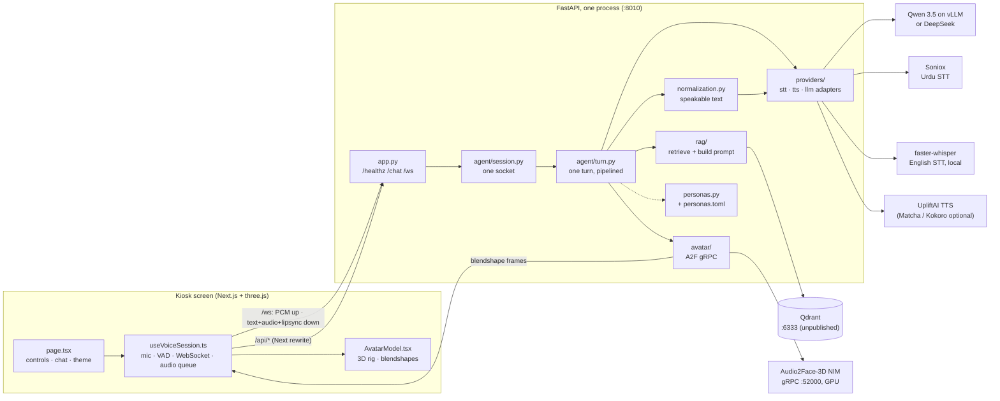
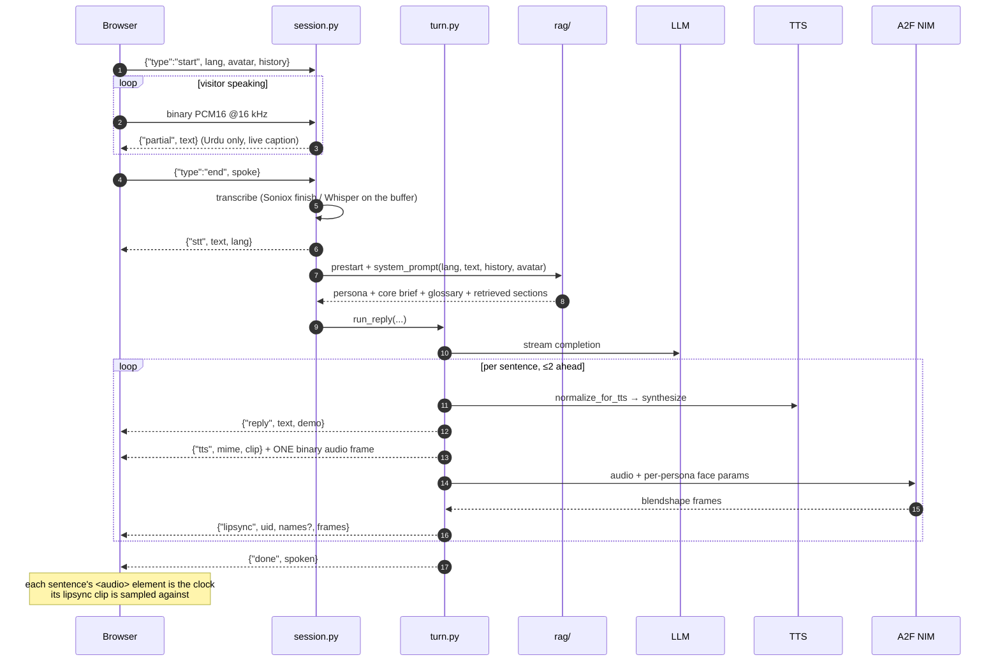
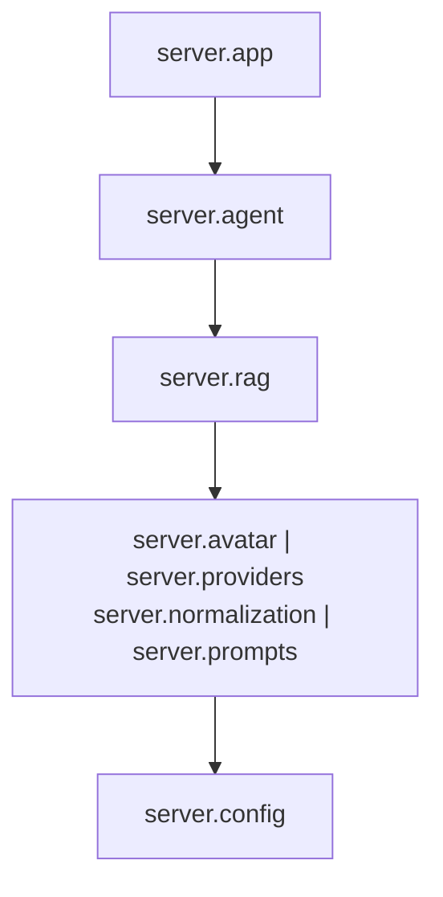
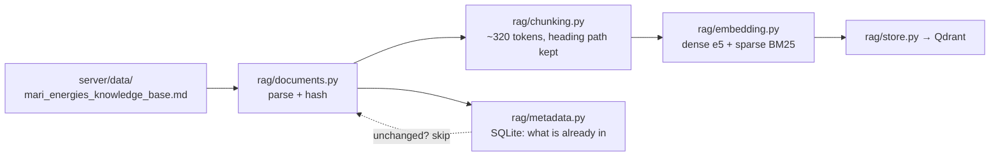
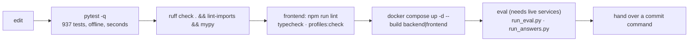

# Repo map

**What every folder stores, what every file does, and how the work flows.**

This is the reference you keep open while finding your way around. It answers "where does
this live?" and "what is this file for?" — one entry per file.

It is deliberately *not* the other docs:

| Read this | When you want |
|---|---|
| **REPO_MAP.md** (this file) | Where something lives, what a file does, how the pieces connect |
| [`ARCHITECTURE.md`](ARCHITECTURE.md) | How the system is shaped and **why** — read before any structural change |
| [`CLAUDE.md`](CLAUDE.md) | The conventions a change must follow, and the checks to run |
| [`docs/decisions/`](docs/decisions/) | Why one structural choice was made over another (8 ADRs) |
| [`MARI_INTERACTIVE_KIOSK_GUIDE.md`](MARI_INTERACTIVE_KIOSK_GUIDE.md) | A long-form walkthrough with how-to recipes |
| [`README.md`](README.md) | Getting it running |

> **State of the tree, 2026-10-08.** The current refactor — `server/rag/` (was
> `server/services/`), `server/personas.{py,toml}`, `server/agent/{policy,session}.py`,
> `pyproject.toml`, `docs/decisions/`, `eval/baselines/`, the new tests — is **in the
> working tree but not committed**. `git log` will not explain these files; their module
> docstrings will. See [§9](#9-current-state-and-known-drift).

---

## Contents

1. [The flows](#1-the-flows)
2. [Folders at a glance](#2-folders-at-a-glance)
3. [Root files](#3-root-files)
4. [`server/` — the backend](#4-server--the-backend)
5. [`frontend/` — the kiosk UI](#5-frontend--the-kiosk-ui)
6. [`tests/`](#6-tests)
7. [`eval/`](#7-eval)
8. [`scripts/`, `docs/`, `.github/`, `deploy/`, `vendor/`, `new-machine-setup/`](#8-supporting-folders)
9. [Current state and known drift](#9-current-state-and-known-drift)
10. [Where new code goes](#10-where-new-code-goes)

---

## 1. The flows

### 1.1 The system

One backend process, one browser, and the things that need their own machine: Qdrant
because it is a database, the Audio2Face NIM because it needs a GPU. Everything else is
a vendor API behind an adapter.



### 1.2 One spoken turn

The browser decides when the visitor stopped talking. The server does STT → retrieve →
LLM → TTS → lip-sync, **one sentence at a time**, with synthesis running up to two
sentences ahead of what is being sent.



**The rule that shapes this:** one WebSocket per turn, no server-side conversation state
— the browser sends the history it wants considered ([ADR 0004](docs/decisions/0004-one-websocket-per-turn.md)).

### 1.3 The backend's import layers

A package may import from the ones **below** it, never above. This is a contract in
`pyproject.toml`, checked by `lint-imports` in CI — not a convention.



`|` means those four must not import each other either. A second contract forbids
`server.agent` and `server.app` from importing `httpx`, `grpc`, `qdrant_client` or
`fastembed` directly — business logic reaches a vendor through an adapter
([ADR 0003](docs/decisions/0003-ports-and-adapters-for-vendors.md)).

### 1.4 Knowledge in (ingestion)

Runs on startup and is idempotent: a file is re-embedded only when its SHA-256 changes.



### 1.5 A question out (retrieval)

Nine stages, each timed, each degrading rather than failing the turn.

```mermaid
flowchart LR
  Q["question"] --> C["1 fix STT mishearings<br/>transcript.py"]
  C --> RW["2 rewrite if elliptical<br/>rewriter.py"]
  RW --> E["3 embed dense + sparse<br/>(Urdu expanded for BM25)"]
  E --> H["4 hybrid search + RRF<br/>store.py"]
  H --> RR["5 rerank (OFF by default)"]
  RR --> G["6 relevance gate"]
  G --> X["7 expand to whole section"]
  X --> GL["8 inject glossary"]
  GL --> AS["9 assemble context<br/>generation.py"]
  AS --> P["system prompt"]
```



### 1.6 The dev loop



Nothing is bind-mounted into the containers, so **rebuild the service you changed** or
you are testing the old image. The full check list lives in
[`CLAUDE.md`](CLAUDE.md#before-you-say-you-are-done).

---

## 2. Folders at a glance

| Folder | Stores | Size |
|---|---|---|
| `server/` | The whole backend: routes, the turn, retrieval, vendor adapters, prompts, personas, the corpus | 58 files |
| `frontend/` | The Next.js kiosk UI and the three.js avatar, its tests and the 3D rigs | 47 tracked + models |
| `tests/` | The offline pytest suite and the two golden snapshots | 26 modules, 937 tests |
| `eval/` | Quality measurement against live services, plus the baselines a run is gated on | 7 scripts + fixtures |
| `scripts/` | Developer tools: dev stack, ingest, GLB optimiser, lip-sync audit, provider self-test | 7 files |
| `docs/` | Decision records and the measurement notes behind tuned numbers | 8 ADRs + 2 notes |
| `.github/` | CI, the daily security audit, Dependabot, the Claude review bots | 5 files |
| `deploy/a2f/` | The Audio2Face NIM as its own GPU compose stack | 4 files |
| `vendor/` | The one wheel that must be installed `--no-deps` | 1 file |
| `new-machine-setup/` | A USB kit that turns a fresh Linux Mint PC into a kiosk. **Gitignored — holds real keys** | 6 files |
| `.run/` | Logs and pid files written by `scripts/dev.sh`. Gitignored | — |

---

## 3. Root files

| File | What it does | Touch it when |
|---|---|---|
| `README.md` | The front door: what MARI is, the stack, where to look, how to run it | The run steps or the doc index change |
| `ARCHITECTURE.md` | How the system is shaped and why; the package diagram, the turn, the invariants | A package boundary, the turn pipeline, the wire contract or deployment changes |
| `CLAUDE.md` | Conventions: the one-way import rule, presenters-are-data, one client per service, comments say *why*, the must-pass check list, the pinned-baseline table | A convention or a required check changes |
| `MARI_INTERACTIVE_KIOSK_GUIDE.md` | Long-form walkthrough of everything, ending in a known-drift section | A how-to recipe changes |
| `REPO_MAP.md` | This file | A file or folder is added, moved or removed |
| `README-RAG.md` | The retrieval design document and every measurement behind `rag/settings.py` | You re-measure a retrieval parameter |
| `pyproject.toml` | The single config for **ruff, pytest, mypy and import-linter**. No build system — the app ships as a container. Holds the layer contract and ~15 per-module lint exemptions, each with the step that removes it | Adding a lint rule, retiring an exemption, adding a pytest marker, changing the layering |
| `requirements.txt` | Backend runtime deps, installed by `server/Dockerfile`. `kokoro` and `nvidia-ace` are commented out on purpose (a numpy pin and a protobuf pin) | Adding a backend runtime dependency — then rebuild the image |
| `requirements-dev.txt` | Dev/CI only: pytest, ruff, mypy, import-linter, pip-audit, PyYAML. Never in the image | Adding a dev tool |
| `docker-compose.yml` | The only compose file for the kiosk: `qdrant` + `backend` + `frontend`. Declares **no networks** (Coolify injects its own) and does not include A2F | Service wiring, ports, volumes, env plumbing, container hardening |
| `docker-compose.override.yml` | **Gitignored, local only.** Joins `backend` to the A2F stack's network so `APP_A2F_URL=nim:52000` resolves | You run `deploy/a2f/` on the same host |
| `.env.example` | The only description of a deployment's environment. Kept in step with the code by `tests/test_env_example.py` | `config.py` or `rag/settings.py` gains or loses a setting |
| `.env`, `.env.bak-*` | Live local config and two stale snapshots. Gitignored, **contain real credentials** | Never — the `.bak` files are forensics, not a template |
| `.dockerignore` | Keeps the build context small and local state out of images — notably `server/data/.rag_metadata.sqlite*`, so a developer's "already ingested" record is never baked in | Adding a big local artefact |
| `.gitignore` | Standard ignores plus **the model allowlist**: `frontend/public/models/*` is ignored, then each shipped rig re-allowed by name | A rig is added or superseded — keep it in step with `models.ts` |
| `.gitattributes` | `* text=auto eol=lf` | Never |

---

## 4. `server/` — the backend

### 4.1 Top level

| File | What it does |
|---|---|
| `app.py` | The FastAPI app and its entire HTTP/WS surface, ~90 lines. `GET /healthz` (readiness of every provider + RAG), `POST /chat` (text only, non-streaming), `WS /ws` (one line: `await VoiceSession(sock).run()`). Startup loads prompts synchronously, then warms providers, A2F and RAG in the background |
| `config.py` | Every non-retrieval setting, read once from `.env` merged under real env vars (real env wins). Also the readiness predicates `llm_ready()`, `stt_ready()`, `tts_ready()`, `status()`. The bottom layer — almost everything imports it |
| `personas.py` | **The only module allowed to read a presenter id.** Loads `personas.toml` and hands out frozen `Persona` objects; `get_persona()`, `default_persona()`, `all_personas()`, `tts_engine()`. Everything else takes a `Persona` and asks it for what it needs |
| `personas.toml` | The presenter data: display name, grammatical gender, which Urdu engines are allowed, voice ids *by config setting name*, and the per-persona A2F face params and 26 blendshape multipliers. The first table is the default — no `"female"` literal anywhere |
| `normalization.py` | Rewrites a reply into what the voice should **say**: numbers, acronyms, ranks and honours, addresses, formulae, URLs, brand respellings. Only the TTS payload changes; the browser still shows the model's text |
| `kokoro_lexicon.py` | Per-word IPA for the Kokoro English voice, which cannot read Urdu script. Provenance and audit method are in the docstring — not a table to fix by eye |
| `Dockerfile` | The CPU backend image: Python 3.11-slim, the A2F wheel `--no-deps`, `uvicorn server.app:app` on 8010 |
| `__init__.py` | Makes `server` a package. One docstring line |

### 4.2 `server/agent/` — one conversation turn

| File | What it does |
|---|---|
| `session.py` | **One WebSocket connection**: the receive loop, the per-message handlers and the per-connection state (lang, presenter, PCM buffer, Soniox stream, the browser's history). An unknown message type is ignored on purpose, so a newer browser can't break an older server |
| `turn.py` | **One reply turn.** Streams sentences → TTS → audio frames → A2F clips, keeping synthesis up to two sentences ahead while sending strictly in order. Holds the send lock that keeps each `{"tts"}` header glued to its audio bytes |
| `responder.py` | Produces the reply text: builds the messages (`build_messages` is public so the eval grades the real prompt), streams the LLM, splits sentences, applies the fixes, and salvages a partial reply rather than apologising |
| `policy.py` | The single decision "do we ask the LLM at all, and if not what do we say" — pitch line, demo line, or go ahead. Was duplicated per call site, which is how `/chat` and the streaming path drifted |
| `context_budget.py` | Keeps the request inside the 8192-token window, estimating tokens **per script** (Urdu 1.8 chars/token, Latin 3.5). Trims only the retrieved context; persona and core brief are never cut |
| `greeting.py` | Whether a message is a greeting or an ask for an introduction, and whether the visitor offered a salam (so the reply returns it rather than repeating it). Pure regex, no `server` imports |
| `reply_fixes.py` | Forces exactly one correct salam opener, and fixes Urdu verb/possessive agreement for the speaker's gender. Dispatches on `grammatical_gender`, never on the id |
| `script_fixes.py` | Puts names, the brand and abbreviations back into **Latin script** in Urdu replies — the model ignores that prompt rule about half the time. Mines the corpus at runtime for acronyms |
| `replies.py` | Reads the fixed lines from `prompts/replies.toml`, keyed by persona because the Urdu verb carries the speaker's gender and these lines skip the agreement fix |
| `speech.py` | The 16-line seam between a sentence and audio: pick the provider, normalise if it wants spoken form, synthesise |

### 4.3 `server/providers/` — vendor adapters

| File | What it does |
|---|---|
| `base.py` | The ports: two `typing.Protocol`s, `STTProvider` and `TTSProvider`. Callers depend on these, not on dispatch code |
| `llm.py` | **The** OpenAI-compatible chat client — there is exactly one. Adds `enable_thinking: false` for vLLM only; raises when the upstream sends an `{"error"}` frame inside a 200 stream, which is how a context overflow arrives |
| `stt.py` | Soniox one-shot and streaming (live Urdu partials), faster-whisper local, Whisper remote, plus WAV/PCM helpers and the "Mary" → "Mari" repair |
| `tts.py` | Uplift, Matcha, Kokoro local and remote, and the persona-driven factory. Nothing here knows which presenters exist |
| `__init__.py` | The adapter-layer facade: `stt()`, `get_tts_provider()`, `warm()`, `SonioxStream`, the PCM helpers |

### 4.4 `server/rag/` — question → system prompt

Was `server/services/`; the move was mechanical apart from `generation.py` switching to
personas-as-data.

| File | What it does |
|---|---|
| `__init__.py` | **The facade** and the owner of the degradation policy: if Qdrant is down or ingestion never ran, `system_prompt()` still returns persona + core brief + "say you don't have that information". `startup()`, `prestart()`, `retrieve()`, `health()` |
| `settings.py` | Every retrieval tunable as a `MARI_RAG_`-prefixed pydantic-settings model, importable with no model or network. Every number is a measurement — see `docs/retrieval_tuning_notes.md` |
| `retriever.py` | **The one retrieval path**, all nine stages (§1.5), each timed, none able to fail a turn |
| `store.py` | All Qdrant access in one module, so collection, vector and payload-index names cannot drift between ingestion and retrieval. Hybrid search is one query with server-side RRF |
| `embedding.py` | Dense, sparse and reranker inference through FastEmbed/ONNX, every entry point also available on a worker thread so CPU work never stalls the audio being streamed |
| `chunking.py` | Structure-aware chunking: every chunk carries its heading path, tables stay whole, oversized paragraphs split at sentence ends. Token counting is injected, so it tests without a model download |
| `documents.py` | File → text → chunks for md/txt/pdf, plus `file_hash`. Hashes **bytes**, not mtime — an mtime check would re-embed the corpus on every deploy |
| `ingestion.py` | Startup ingestion: idempotent, hash-based, safe on every boot |
| `metadata.py` | The SQLite record of what is already ingested, and the only place a **failed** ingest is recorded |
| `expansion.py` | Urdu → English expansion for the **sparse channel only** (the corpus is English). The dense channel keeps the original text |
| `expansion_tables.py` | The hand-tuned data for the above. Worth fifteen points of hit@5 on Urdu questions |
| `generation.py` | Assembles the system prompt. Owns `CONTEXT_HEADER`, which `context_budget.py` finds by string search — a cross-layer contract: change the literal and context trimming silently stops |
| `glossary.py` | Mines `ABBR (Full Form)` pairs from the corpus and injects the ones the query mentions, because the chunk that defines a term may never rank |
| `rewriter.py` | Turns an elliptical follow-up into a self-contained query. Conditional, timeout-guarded, fails open |
| `transcript.py` | Fixes STT mishearings of corpus words **before** anything reads the query — one word decides which section is retrieved |

### 4.5 `server/prompts/` and `server/data/`

| File | What it does |
|---|---|
| `prompts/__init__.py` | Loads every prompt file once; a missing or empty file raises at startup so a bad deploy fails loudly. Builds the persona × language cross-product — **adding a persona to the TOML without its four prompt files crashes startup** |
| `prompts/system/{female,male}_{english,urdu}.md` | The persona and rules block in every system prompt: identity, "never reveal you are an AI", the language lock, guardrails, answer shape, and for Urdu the gendered forms |
| `prompts/greeting/{female,male}_{english,urdu}.md` | Appended only on a greeting turn, overriding the system prompt's "don't greet, don't introduce yourself" |
| `prompts/core_brief.md` | The company facts injected into **every** prompt — the backstop the kiosk answers from while a cold container is still downloading models |
| `prompts/no_context_{english,urdu}.md` | The instruction used when retrieval found nothing: don't answer from your own knowledge |
| `prompts/query_rewriter.md` | The one-line system prompt for the follow-up rewriter |
| `prompts/replies.toml` | The fixed lines — demo, no-speech, pitch — per persona and language. The Urdu lines differ by gendered verb |
| `prompts/README.md` | The naming scheme, the assembly order, and "change the file and restart the backend" |
| `data/mari_energies_knowledge_base.md` | **The corpus** — the single grounding document, 96 chunks. Numbered `##`/`###` headings are load-bearing: retrieval keys off them and section expansion completes a whole `###` |
| `data/README.md` | The corpus format rules and the `APP_KNOWLEDGE_FILE` swap |
| `data/.rag_metadata.sqlite` | Local runtime state, gitignored. Delete it and the next boot re-embeds everything |

---

## 5. `frontend/` — the kiosk UI

### 5.1 `app/` and `components/`

| File | What it does |
|---|---|
| `app/page.tsx` | The whole kiosk, one client component: owns language, theme, presenter, chat-open and avatar-ready state, and composes everything else. Switching presenter stops the voice and re-arms the loading overlay |
| `app/layout.tsx` | Root layout, the Inter font, and a pre-paint inline script that applies the stored theme so there is no flash |
| `app/page.module.css` | The layer stack (background 0 · avatar 10 · controls 20 · chat 30 · toast 40) and the four background images |
| `app/globals.css` | The design tokens. `--s` is one reference unit for the whole layout and is redefined at the portrait breakpoint, which is an **aspect ratio** (`max-aspect-ratio: 6/5`), not a width |
| `app/netcheck/page.tsx` | `/netcheck`: times a cold and a warm fetch of the avatar from the kiosk itself, reporting TTFB, throughput and whether caching worked |
| `components/AvatarStage.tsx` | The mount box. Loads the scene with `ssr: false` to keep three.js off first paint, and hides the canvas by opacity until the rig is posed — otherwise the glTF bind pose (a T-pose) is visible |
| `components/ControlDock.tsx` | The ✕ / mic / pause row. Writes the smoothed voice level into a CSS variable in a rAF loop, so the halo animates without re-rendering |
| `components/LanguageBar.tsx` | Language pill, presenter switch (icon pill on wide screens, a compact toggle on narrow) and the theme button. Holds the only name → icon map, keyed by the profile's `icon` field |
| `components/ChatPanel.tsx` | The launcher with an unread badge, the message log with the live partial, and the composer (Enter sends) |
| `components/LoadingScreen.tsx` | The percentage, from `onAvatarProgress` — it never opens its own fetch, which once made it a third parallel copy of the same download |
| `components/icons.tsx` | Nine inline SVG icon components |
| `components/*.module.css` | Per-component geometry, all derived from the `--s` tokens |

### 5.2 `components/avatar/` — the 3D presenter

| File | What it does |
|---|---|
| `AvatarScene.tsx` | The R3F canvas: manual camera driven by the container's size, the seven-light studio rig lerped per conversation state and voice level, per-theme exposure, and an error boundary that retries once with a cache-bust |
| `AvatarModel.tsx` | The biggest file in the repo. Loads the rig through the shared fetch, crossfades three animation layers by matching the outgoing pose, runs the material passes (skin, tints, alpha cuts, hand scale, makeup), blinks procedurally, and applies A2F weights every frame |
| `models.ts` | **The presenter registry** — the asset facts per rig: url, byte counts, the three loop windows, `hasMorphs`, grammatical gender, labels, icon. Spreads in `RIG_TUNING`, so consumers read one object |
| `tuning.ts` | Every number that decides how the scene and the rigs **look**: camera, light colours and placement, per-state intensities, and `RIG_TUNING` per presenter. Values only, no logic |
| `state.ts` | `AvatarState` and the `Mode → AvatarState` map, kept free of three.js so the page can import it without pulling in R3F |

### 5.3 `hooks/` and `lib/`

| File | What it does |
|---|---|
| `hooks/useVoiceSession.ts` | The browser half of a turn: mic capture, the RMS voice-activity detector that decides when the visitor stopped, the WebSocket protocol, the audio playback queue, the transcript, and the lip-sync handoff. Each sentence's `<audio>` element is the clock its clip is sampled against |
| `lib/avatarFetch.ts` | The **one shared download** of a rig, with progress. Must stay a single plain GET of a stable URL: ranged responses are never written to the browser's disk cache, which made every reload re-download the model |
| `lib/blendshapePlayer.ts` | Buffers lip-sync clips and samples the active one against its clock. Owns the per-rig calibration and the `?a2f*` debug overrides |
| `lib/a2fMorphs.ts` | Applies A2F weights to the rig's morph targets by name, clamps, ramps and decays them. Known misses are documented: 52 shapes emitted, 50 land |
| `lib/avatar.ts`, `lib/theme.ts` | Persist the chosen presenter and theme in `localStorage`, wrapped in try/catch |
| `lib/i18n.ts` | The UI copy for both languages, including the gendered Urdu status strings |
| `lib/endpoints.ts` | The REST paths and `wsUrl()` — the WebSocket goes direct to the backend because Next's dev proxy does not forward upgrades |
| `lib/debug.ts` | The debug seams: singleton registration (a module loaded twice keeps two states and the mouth silently stops), and the `window.__MARI` probes the e2e tests read |

### 5.4 Frontend tests, scripts, assets and config

| File | What it does |
|---|---|
| `test/avatarProfiles.test.ts` | Pins the registry's **shape**: every presenter defines the same fields, no field is `undefined`, ids match their keys, an unknown id falls back, and lip-sync calibration is present and sane |
| `test/blendshapePlayer.test.ts` | Pure arithmetic over the clip buffer: interpolation, the held tail, calibration stacking, and that a lowercase shape-gain key is required. Also that `waitForFrames` **gives up** rather than holding the audio back |
| `test/fixtures/avatar-profiles.json` | The snapshot of every per-presenter look value. Compared by exact string equality |
| `scripts/dump-avatar-profiles.mjs` | Writes or checks that snapshot (`npm run profiles:write` / `profiles:check`) by compiling `models.ts` in isolation — so a refactor of the avatar config has to prove it changed no pixel |
| `e2e/kiosk.spec.ts` | Playwright, every test aimed at a **silent** failure: the canvas really has a WebGL context, each singleton module is loaded exactly once, the model is fetched exactly once, a presenter round-trip fetches nothing new and **does not darken the avatar**, and a typed question produces both a reply and real lip-sync frames |
| `e2e/helpers.ts` | The accessible-name constants and the shared waits. Needs `docker compose up -d` first — there is no `webServer` |
| `package.json` | Deps and the scripts: `dev`, `build`, `lint`, `typecheck`, `profiles:check/write`, `test`, `e2e`. Next 15.5.26 and React 19.1.9 are pinned exactly |
| `next.config.ts` | Standalone output, `/api/*` rewrites, the gzip and immutable-cache headers for `/models/*`, and `images.unoptimized` to keep `sharp` out of the runtime. **The rewrite target is baked in at build time** |
| `eslint.config.mjs` | Two project rules: `lib/` may not import from `components/` or `hooks/`, and a bare `"male"`/`"female"` literal is an error outside the profile files. Current exemptions are listed with the phase that removes them |
| `tsconfig.json`, `vitest.config.ts`, `playwright.config.ts` | Strict TS with the `@/*` alias; vitest over `test/**`; Playwright over `e2e/` with one worker and a software GL renderer |
| `Dockerfile` | Three stages on node:24. `npm audit --audit-level=critical` **fails the build** rather than shipping a known-vulnerable container; the build heap is capped so a small VPS doesn't OOM; the server runs as a non-root user |
| `public/models/*.glb(.gz)` | The rigs. Both the raw `.glb` and the served `.gz` are kept; only the `.gz` is requested |
| `public/bg-*.png` | Backgrounds: desktop and mobile × dark and light |

---

## 6. `tests/`

**937 tests, 26 modules, all offline** — no network, no Qdrant, no LLM, no GPU. Run with
`pytest -q` from the repo root; all config is in `pyproject.toml`.

| File | Pins |
|---|---|
| `test_tts_spoken.py` | How a reply is rewritten for the voice: English spells numbers out, Urdu keeps its digits |
| `test_names_and_ranks.py` | Pakistani names, military ranks and honours, every expectation verified by a live round trip |
| `test_addresses_and_symbols.py` | Addresses, contact details, formulae and symbol abbreviations, plus negatives like "24/7" |
| `test_places.py` | Gas fields, districts, formations, wells and programme names in Latin script |
| `test_english_normalise.py` | The English-only rules, and that they stay out of Urdu |
| `test_kokoro_spoken.py` | The Kokoro path: inline IPA instead of Urdu script, every phoneme checked against the voice's own vocab |
| `test_script_fixes.py` | Urdu replies put back into Latin script — every case is a reply the model actually produced |
| `test_greetings.py` | The fixed Urdu salam opener, which the model gets wrong about a third of the time |
| `test_personas.py`, `test_persona_gender.py` | Presenter selection, voice choice and Urdu gender agreement, spoken and on screen |
| `test_personas_are_data.py` | **The rule itself**: no presenter id anywhere outside `personas.py`, every persona fully specified, and the frontend and backend agree on grammatical gender |
| `test_context_budget.py` | The request fits the 8192-token window, and an error frame inside a 200 stream is not swallowed |
| `test_rag.py` | The retrieval layer without models or Qdrant: prefixes, corrections, expansion, the gate, section expansion, assembly, prompt order, hash-skip |
| `test_chunking.py` | The chunking guarantees the old word-window chunker broke |
| `test_urdu_expansion.py` | The Urdu → English tables that feed the sparse channel |
| `test_prompts_and_glossary.py` | The prompt files load; the glossary extracts, matches and formats |
| `test_golden_snapshots.py` | `fixtures/golden.json` — what the kiosk says and sends |
| `test_ws_endpoint.py` | `fixtures/ws_golden.json` — the `/ws` endpoint over a real test socket, including every lip-sync frame and the per-presenter A2F tuning |
| `test_turn_timing.py` | That synthesis **overlaps** sending instead of serialising. Nothing on the wire shows this, so this file is its only guard |
| `test_matcha_tts.py` | Matcha routing: only the female presenter's Urdu moves, unnormalised, with an Uplift fallback |
| `test_stt_mari_correction.py`, `test_soniox_partials.py`, `test_no_speech_reply.py` | STT repairs, a partial-less Soniox message, and the empty-transcript rule that stopped the kiosk apologising to an empty room |
| `test_factcheck.py`, `test_eval_gate.py` | The eval scorer's matching rules, and the regression gate's arithmetic |
| `test_env_example.py` | `.env.example` lists every setting the code reads, no dead settings, and no secret has a value |
| `golden_harness.py` | Collects behaviour for the golden snapshot through the outermost seams only. **Regenerate: `python -m tests.golden_harness --write`** |
| `ws_harness.py` | The same for `/ws`, with a deterministic fake A2F client. **Regenerate: `python -m tests.ws_harness --write`** |
| `retrieval_cases.py` | 61 Urdu questions paired with the KB section each should hit, in the register people actually speak |

> **The rule:** a snapshot mismatch means behaviour changed. Fix the code. Regenerate only
> for a deliberate change, in the same commit, with the reason in the message.

---

## 7. `eval/`

Tests check the code; **eval measures quality against the live models.**

| File | What it does |
|---|---|
| `run_eval.py` | Scores **retrieval** over `questions.yaml`: hit@k, MRR, fact recall, abstain rate, latency per stage. Also holds the regression gate (`compare_to_baseline`, per-metric tolerances, 10% latency slack) |
| `run_answers.py` | Scores **what the visitor hears**: a grade per case, and a cause for every missing fact — `retrieval` (never in the context), `generation` (given and dropped) or `cap` (lost to the token limit). That split is what decides whether a failure is a chunking problem or a prompt problem |
| `calibrate.py` | Sweeps the relevance threshold — the one parameter whose job is to return *nothing*, so it cannot be tuned by looking at hit@k |
| `factcheck.py` | The scorer: substring matching, not similarity. Tries plain canonicalisation first, then the kiosk's own TTS normaliser, so a change there can add matches but never remove one |
| `make_answer_cases.py` | Drafts cases from the tester's spreadsheet. Prints to stdout and never writes a file, so a second run cannot overwrite the human review |
| `questions.yaml` | 150 retrieval questions, including 16 negatives the corpus does not cover — without those, a retriever that answers everything scores perfectly |
| `answers.yaml` | 32 curated answer cases: the required facts, each with its accepted surface forms |
| `data/tester_eval.csv` | The tester's 342 graded rows — the source of truth for "did this get better?" |
| `baselines/README.md` | What the kiosk measured **before** the refactor, the two invariants ("Not Matched stays at 0", fact recall must not drop ~2 points), and the exact commands to re-run |
| `baselines/retrieval.json`, `baselines/answers.{json,jsonl}` | The recorded numbers a gated run is compared against |
| `runs/` | Working output. Gitignored; nothing here is a baseline |

```bash
# offline first — until derived grades agree with the tester's, no live claim is trustworthy
python eval/run_answers.py --score-only

# live, gated (from the HOST: the container grades whatever was built last)
docker compose up -d
set -a && . ./.env && set +a
export MARI_RAG_QDRANT_HOST=$(docker inspect -f \
  '{{range .NetworkSettings.Networks}}{{.IPAddress}}{{end}}' \
  mari-interactive-kiosk-main-qdrant-1)

python eval/run_eval.py    --k 5      --baseline eval/baselines/retrieval.json
python eval/run_answers.py --repeat 2 --baseline eval/baselines/answers.jsonl
```

Qdrant's port is deliberately not published, which is why the host needs the container's
address.

---

## 8. Supporting folders

### `scripts/`

| File | What it does |
|---|---|
| `dev.sh` | `start\|stop\|restart\|status` for the whole local dev stack: backend, frontend, the A2F NIM and optionally Matcha. Logs and pids under `.run/`. Launches with `setsid` so stopping reaches the children `next dev` forks |
| `rag_ingest.py` | Ingest the corpus without booting the server — what you want while tuning chunking. `--force` rebuilds, `--recreate` drops the collection **and** the metadata DB (dropping one without the other makes every file look already-ingested against an empty index) |
| `optimize_glb.py` | Shrinks a rig by removing what the kiosk provably never reads: animation outside the three loop windows, float32 rotations, morph-target normals. Each win measured; two neighbouring ideas recorded as rejected |
| `lipsync_audit.py` | Measures how each rig's mouth actually moves under real A2F frames — lip seal on m/b/p, closure between words, vowel opening, rounding, visible teeth, symmetry — applying weights exactly as the browser does. The 4-step record → audit → fit → verify workflow is in its docstring, and it is how the numbers in `personas.toml` were fitted |
| `selftest.py` | Three timed round trips from a host that can reach the endpoints: LLM answers, Uplift → Soniox (Urdu), TTS → Whisper (English) |
| `run_web.sh`, `run_web.ps1` | Launch the backend with uvicorn, preferring a Python 3.12 venv. Called by `dev.sh` |

### `docs/`

| File | The decision, in one line |
|---|---|
| `decisions/0001-modular-monolith.md` | One backend process with an enforced one-way import rule; only Qdrant and the A2F NIM get their own process |
| `decisions/0002-borrow-pipecats-shape-not-pipecat.md` | Take Pipecat's shape — a session per connection, a turn of stages, one adapter per vendor — not the dependency |
| `decisions/0003-ports-and-adapters-for-vendors.md` | Every speech and LLM vendor behind a Protocol, with one selection function as the only code that names a vendor |
| `decisions/0004-one-websocket-per-turn.md` | One socket per turn and no server-side conversation state; the browser sends the history it wants considered |
| `decisions/0005-audio2face-as-a-separate-stack.md` | A2F lives in its own GPU stack and is optional — with no `APP_A2F_URL`, turns run normally with a still mouth |
| `decisions/0006-personas-as-data.md` | Presenters are data in `personas.toml`; `personas.py` is the only module that reads an id |
| `decisions/0007-keep-the-wire-format.md` | Don't redesign the wire format — pin it with an 18-scenario snapshot of the full ordered frame list |
| `decisions/0008-right-sizing-the-tooling.md` | Adopt only tools that catch a defect this codebase actually had; the declined ones are recorded with reasons |
| `pronunciation_notes.md` | The round-trip evidence behind every rule in `normalization.py`, and what was tried and rejected. The method it mandates: synthesise the phrase and transcribe it back **before** adding a rule |
| `retrieval_tuning_notes.md` | The measurements behind every default in `rag/settings.py`, including the reranker comparison that is why it is off |

### `.github/`

| File | What it does |
|---|---|
| `workflows/ci.yml` | What has to hold for a change to land, with no secrets and no GPU. Three jobs: **backend** (ruff → lint-imports → mypy → pytest → advisory pip-audit), **frontend** (lint → typecheck → profiles:check → build), **containers** (compose config + both image builds) |
| `workflows/security-audit.yml` | A daily `npm audit` on the frontend's runtime deps. The daily run is the point: the 2026-09 compromise came from an advisory published after the last deploy |
| `dependabot.yml` | Weekly updates for npm, pip, both Dockerfiles and the Actions themselves, with minor and patch grouped so majors stay separate |
| `workflows/claude.yml`, `workflows/claude-code-review.yml` | The `@claude` responder and the automatic PR review, the latter weighted towards this project's real failure modes: async races, leaked session state, unhandled provider errors, secrets outside `config.py`, undisposed audio and mic resources |

### `deploy/a2f/`

| File | What it does |
|---|---|
| `docker-compose.yml` | The Audio2Face NIM as its own stack, published on **loopback only** because it has no authentication of its own. A one-shot `init` profile downloads the ~10 GB model into a named volume that survives other stacks being torn down |
| `configs/deployment_config.yaml` | The NIM's deployment settings. `stream_number` is the one to know: each stream holds its own TensorRT context, so a 6 GB GPU OOMs above 1 — and `APP_A2F_MAX_CLIPS` must stay at or below it |
| `configs/advanced_config.yaml` | Tuning: queue sizes, streaming FPS, and the TensorRT precisions. Editing the shapes has no effect until the cached engine is deleted from the volume |
| `.env.example` | `NGC_API_KEY` and the cache-volume options. Configures the **container**; the root `.env`'s `APP_A2F_*` configure the app's client |

### `vendor/`

One file: `nvidia_ace-1.2.0-py3-none-any.whl`, NVIDIA ACE's generated gRPC stubs. Vendored
because it must be installed `--no-deps` — its metadata pins a protobuf version that
conflicts with onnxruntime, while the stubs themselves work fine on newer runtimes.

### `new-machine-setup/` — gitignored, holds real keys

A USB-copyable kit that takes a brand-new Linux Mint PC to a running kiosk and leaves a
desktop icon behind.

| File | What it does |
|---|---|
| `START HERE.txt` | The plain-language front page for whoever is holding the USB stick |
| `SETUP.md` | The full guide: the quick way, then nine manual steps each ending in a check |
| `install.sh` | The one-shot installer: preflight → driver → Docker → NVIDIA toolkit → repo → config → A2F → kiosk → desktop launcher. Survives the reboot it may need, every step idempotent, and lip-sync is optional so a GPU problem still leaves a working kiosk |
| `start-kiosk.sh` | The presenter's one-click launcher: brings back anything that is down with an escalating start → restart → recreate ladder, keeps a watchdog running, and finishes with a real self-test inside the backend container, translating failures into plain language |
| `docker-compose.override.yml`, `a2f.env`, `.env` | The three settings files `install.sh` copies into place |

---

## 9. Current state and known drift

**The refactor is uncommitted.** `server/rag/`, `personas.{py,toml}`,
`agent/{policy,session}.py`, `pyproject.toml`, `CLAUDE.md`, `ARCHITECTURE.md`,
`docs/decisions/`, `eval/baselines/`, `.github/workflows/ci.yml` and six test modules are
untracked; `server/services/`, `server/rag.py`, `mari_s2s/`, `web/`, `prompt related/`,
the root `Dockerfile` and `requirements-web.txt` are deleted but still tracked. Nothing is
committed, so `git log` will not explain any of it — the module docstrings will.

**One deployment risk.** `models.ts` asks for `/models/male_initial13.glb.gz`, and that
file is **untracked**. The only male rig git knows about is `male_inital12` (note the
misspelling), which is deleted from the working tree. The `.gitignore` allowlist is
already correct, so the files only need adding — otherwise the male avatar 404s in
production and nowhere else, which is the exact failure that allowlist comment warns
about.

**Dead weight.** `frontend/public/models/male_initial12.glb(.gz)` (~111 MB) is superseded
and referenced only in a comment; `bg-mobile-light-2.png` and `-3.png` are unreferenced.
`frontend/.dockerignore` does not exclude `public/models/`, so every rig ships in the image.

**Doc drift to be aware of while reading:**

- `README.md` says 928 tests; the suite collects **937**.
- `README-RAG.md`, `docker-compose.yml`, `.env.example` and `MARI_INTERACTIVE_KIOSK_GUIDE.md`
  still mention `server/rag.py` or `server/services/*`.
- `server/data/README.md` links `../services/` and documents two deleted files.
- `server/prompts/README.md` says an unknown id "falls back to female" — true only because
  female is the first table in `personas.toml`.
- `frontend/app/layout.tsx` still describes a six-range model fetch; it is one plain GET.
- `frontend/README.md` and `next.config.ts` describe the backgrounds as a `<picture>`
  element; they are CSS backgrounds.
- `lib/debug.ts`'s `debugEnabled()` has no call sites, and two e2e files it names don't
  exist (those tests live in `kiosk.spec.ts`).

**Secrets on disk, all gitignored:** `.env`, `.env.bak-2026-10-07`, `.env.bak-lipsync`,
`deploy/a2f/.env`, `new-machine-setup/.env`, `new-machine-setup/a2f.env`.

---

## 10. Where new code goes

| You are adding | It goes in | And you must |
|---|---|---|
| A new speech or LLM vendor | One adapter class in `server/providers/`, routed by the selection function | Implement the Protocol in `base.py`; add the `APP_*` settings to `config.py` **and** `.env.example`; add a readiness line to `status()` |
| A third presenter | A table in `server/personas.toml` | Add all four prompt files and the reply lines, a profile in `models.ts` + `tuning.ts`, then `npm run profiles:write`. No `if` on the id anywhere |
| A retrieval change | `server/rag/` | Re-measure with `eval/run_eval.py` against the baseline, and record the number in `docs/retrieval_tuning_notes.md` |
| A pronunciation fix | `server/normalization.py` (or `kokoro_lexicon.py`) | Round-trip it first, add a test, record the evidence in `docs/pronunciation_notes.md` |
| A prompt change | `server/prompts/` | Make it a general rule, not a word list; check it with `eval/run_answers.py`; restart the backend |
| A new rig | `frontend/public/models/` under a **new filename** | Update `models.ts` bytes and loop windows, `tuning.ts`, the `.gitignore` allowlist, and delete the superseded rig |
| Anything touching the turn or the socket | `server/agent/` | Expect `tests/fixtures/ws_golden.json` and `test_turn_timing.py` to have an opinion |
| A structural change | — | Read `ARCHITECTURE.md` first, and add an ADR in `docs/decisions/` rather than editing an existing one |
