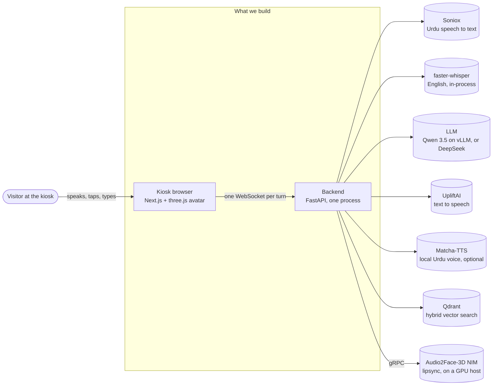
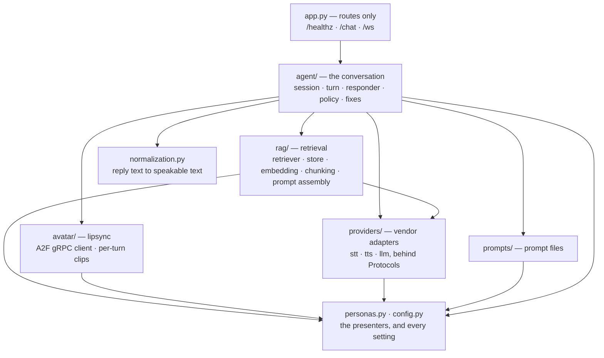
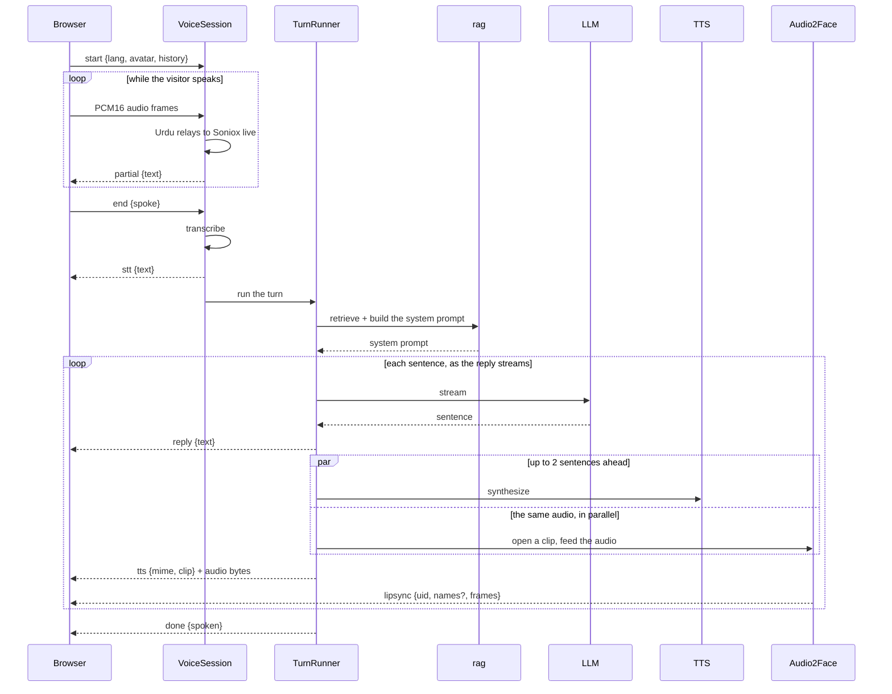
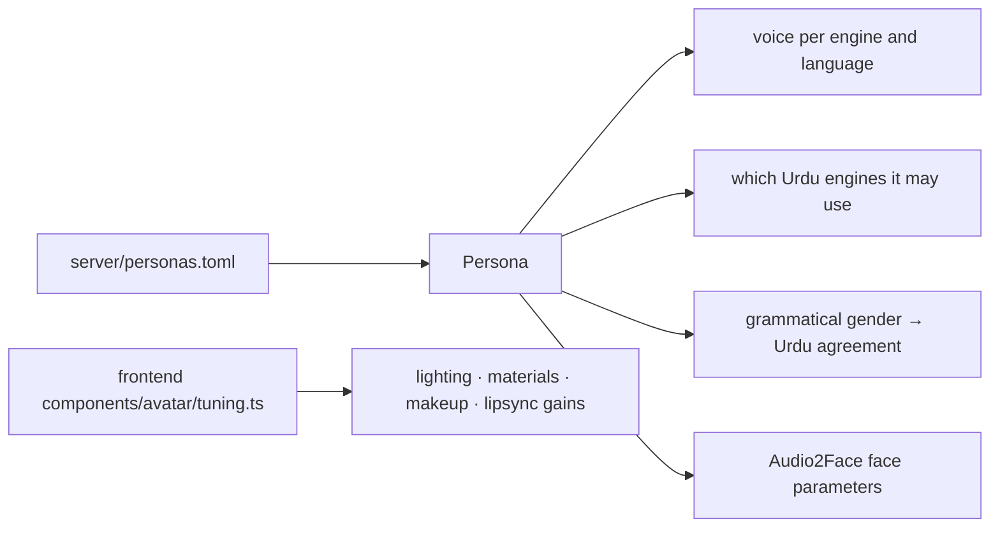
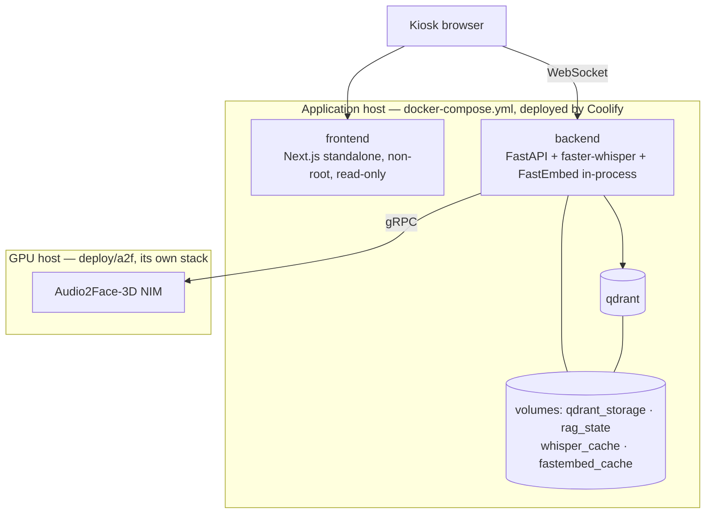

# Architecture

How the MARI kiosk is put together and why. Read this before any structural change.
For running it, see [README.md](../README.md); for the conventions a change has to follow,
[AGENTS.md](../AGENTS.md).

## 1. What it is

A kiosk in a building lobby. A visitor speaks to a 3D presenter on a touchscreen and it
answers questions about Mari Energies from the company's own knowledge base, in English
or Urdu, in one of two presenters' voices, with the avatar's mouth matching the speech.

Everything is driven by one round trip:

> microphone → speech to text → find the relevant passages → LLM → text to speech →
> audio plus mouth movement, back to the browser

The whole product is that loop being fast enough to feel like a conversation, and
truthful enough to be put in front of the public. Every structural decision below
comes from one of those two.

## 2. Context

The browser never talks to a vendor. Every key stays on the server, and the browser's
only contract is the WebSocket described in §6.

## 3. The shape: a modular monolith with adapters at the edge

**One backend process**, divided into packages with one job each and a one-way import
rule between them. Each external vendor sits behind a small interface, so swapping one
means writing one adapter rather than editing the code that calls it.

**Why not microservices.** Speech to text, the LLM and text to speech are already
remote APIs on someone else's servers. Putting our own network hop in front of each
would add latency to a loop whose whole value is latency, and buy no fault isolation we
do not already have — a vendor being down is handled the same way either way (§7). The
two things that genuinely need their own process do have one: Qdrant, because it is a
database, and the Audio2Face NIM, because it needs a GPU.

**Why ports and adapters.** There are four interchangeable speech vendors and two
interchangeable LLM providers, chosen by configuration per deployment. Without an
interface, that choice leaks into every call site — which is what had happened: three
separate HTTP clients for the same LLM, drifted apart.

This follows the structure used by the open-source voice-agent frameworks
([Pipecat](https://docs.pipecat.ai/guides/learn/pipeline),
[LiveKit Agents](https://docs.livekit.io/agents/)): a session object per connection, a
turn assembled from stages, and one "service" class per vendor. We borrowed the shape
rather than the dependency — see [docs/decisions/0002](decisions/0002-borrow-pipecats-shape-not-pipecat.md).

## 4. The backend, package by package

| Package | Owns | Key types |
|---|---|---|
| `app.py` | The HTTP and WebSocket surface, and nothing else. 96 lines. | `ChatIn` |
| `agent/` | One conversation turn, start to finish. | `VoiceSession` (per socket), `TurnRunner` (per turn), `fallback_reply` |
| `rag/` | Turning a question into the system prompt the LLM is given. | `Retriever`, `RetrievalResult`, `GenerationService` |
| `avatar/` | Driving the Audio2Face NIM and shipping its frames. | `A2FClient`, `LipsyncTurn` |
| `providers/` | One adapter per vendor, selected by configuration. | `STTProvider`, `TTSProvider` (Protocols) |
| `normalization.py` | Rewriting a reply into something a voice can read aloud. | `normalize_for_tts` |
| `prompts/` | The prompt text, as files rather than string literals. | `PromptLibrary` |
| `personas.py` | The two presenters, read from `personas.toml`. | `Persona` |
| `config.py` | Every setting, from the environment. | — |

### The import rule

A package may import from the ones **below** it in that diagram, never above, and never
in a cycle.

This is not a convention — it is a contract in
[`pyproject.toml`](../pyproject.toml) (`[tool.importlinter]`) and CI runs `lint-imports`
on every change. Six wrong-way imports remain, each listed in that file by name with
the step that removes it; the list can only shrink.

A second contract says only `rag/` and `providers/` may import a vendor SDK (`httpx`,
`grpc`, `qdrant_client`, `fastembed`). Business logic holding its own HTTP client is
how the three LLM clients happened.

## 5. One spoken turn

**The two timing decisions that matter**, both measured and both guarded by
`tests/test_turn_timing.py`:

1. **Sentence by sentence, not reply by reply.** The visitor hears the first sentence
   while the LLM is still writing the third. Waiting for a whole reply would add
   seconds of silence to every turn.
2. **Synthesis runs two sentences ahead.** Sentence N+1 is being rendered while N is
   playing. Capped at two, so interrupting a turn wastes at most two calls.

Lipsync is deliberately **out of band**: the frames for a sentence arrive on the same
socket but after its audio, tagged with a clip id, and the browser matches them up
against that audio element's own playback clock. The NIM is burst-out — it emits
nothing until a clip's audio ends — so waiting for frames before playing would add its
whole round trip to every sentence.

## 6. The browser contract

One WebSocket per turn. The browser opens it, speaks or types, receives the answer,
and the server closes it.

**Browser to server**

| Message | Meaning |
|---|---|
| `{"type":"start", lang, avatar, history}` | about to speak |
| binary frames | 16 kHz mono PCM16 |
| `{"type":"end", spoke}` | finished speaking; `spoke` is the browser's own voice-detection verdict |
| `{"type":"text", text, lang, avatar, history}` | a typed question instead |

**Server to browser**

| Message | Meaning |
|---|---|
| `{"type":"partial", text}` | live caption while the visitor is still talking |
| `{"type":"stt", text, lang}` | the final transcript |
| `{"type":"reply", text, demo}` | one sentence of the answer |
| `{"type":"tts", mime, clip?}` + binary | that sentence's audio; `clip` ties it to its lipsync |
| `{"type":"lipsync", uid, names?, frames}` | blendshape weights; `names` once per clip |
| `{"type":"warn", message}` | one sentence could not be spoken; the turn continues |
| `{"type":"error", message}` | the turn failed |
| `{"type":"done", spoken}` | the turn is complete |

**No conversation state lives on the server.** The browser sends the history it wants
considered, every turn. Nothing about a visitor outlives their socket — which is also
why there is nothing to clear between visitors.

The contract is pinned by `tests/fixtures/ws_golden.json`: the full ordered frame list
for eighteen scenarios, including the lipsync frames and the per-presenter Audio2Face
tuning. A change to any of it fails the build.

## 7. The kiosk always speaks

A kiosk that falls silent in a lobby is broken in a way a web page is not: nobody
reloads, they walk away. So every stage has a defined answer for its own failure, and
the turn continues.

| If this fails | The visitor gets |
|---|---|
| Retrieval (Qdrant down, models not downloaded, never ingested) | an answer from the core brief, plus the instruction to say when it does not know |
| The LLM, before a word | the canned demo line |
| The LLM, part-way | the half of the answer that arrived |
| Text to speech, one sentence | the remaining sentences, spoken |
| Matcha-TTS (the local Urdu voice) | the same sentence, from Uplift |
| Audio2Face | audio with a still mouth |
| Speech to text | an error, and the socket closes |

Two consequences worth knowing. The container is **healthy before retrieval is
ready**: the backend's health check is liveness only, because a cold start spends
minutes downloading embedding models and a readiness-gated check would put the kiosk in
a restart loop. And `agent/policy.py` is the single place that decides what stands in
for a real answer — it used to be written out at each call site, and the sites drifted.

## 8. Presenters are data

The kiosk offers two presenters. They differ in name, voice, grammatical gender, and
how their rig's mouth is tuned — and in nothing else.

**No code outside `personas.py` reads a presenter id.** It used to: about ten
`if avatar == "male"` branches across text to speech, Audio2Face, the prompts, the
canned replies and the routes, plus twenty hard-coded `"female"` defaults. Adding a
third presenter meant finding every one.

`tests/test_personas_are_data.py` fails if a presenter id appears in code again, if the
two presenters stop defining the same fields, or if the frontend and backend stop
offering the same set. Adding a presenter is now: a table in `personas.toml`, prompt
and greeting files, a profile in the frontend registry, and the rig.

## 9. Configuration

Settings come from the environment, via `.env` locally and Coolify's own environment in
production. Three prefixes, by subject:

| Prefix | Covers | Read by |
|---|---|---|
| `APP_*` | the speech, LLM and Audio2Face providers | `server/config.py` |
| `MARI_RAG_*` | every retrieval tunable | `server/rag/settings.py` (pydantic-settings) |
| `MARI_*` | host, port and the recording aids | `server/config.py` |

A test asserts `.env.example` lists every setting the code reads, so the documented
environment cannot drift from the real one.

Values that belong to a *presenter* rather than a deployment live in `personas.toml`.
Voice **ids** are the seam: which setting holds a presenter's voice is a fact about the
presenter, but the id itself is account-specific, so the TOML names the setting and the
environment supplies the value.

## 10. Deployment

The Audio2Face NIM is **not** in the compose file. It needs a GPU the application host
does not have, it is pinned to a loopback port because the NIM itself has no
authentication, and the kiosk is designed to work without it (§7). It is deployed and
upgraded on its own.

The embedding models run **inside** the backend rather than as a service. They are
called once per turn on the critical path, and a network hop for a 40 ms operation
would be most of its cost.

## 11. Invariants

Things that are true today and must stay true. Each one is enforced, not just asserted:

| Invariant | Enforced by |
|---|---|
| The browser never talks to a vendor | no keys in the frontend; the import contract |
| No package imports upward or in a cycle | `lint-imports` in CI |
| Only `rag/` and `providers/` import a vendor SDK | the `forbidden` import contract |
| No code branches on a presenter id | `tests/test_personas_are_data.py` |
| The kiosk always speaks | the degradation tests; `agent/policy.py` |
| The wire format does not change by accident | `tests/fixtures/ws_golden.json` |
| What the kiosk says does not change by accident | `tests/fixtures/golden.json` |
| Synthesis stays pipelined | `tests/test_turn_timing.py` |
| A presenter's look does not change by accident | `frontend/test/fixtures/avatar-profiles.json` |
| Retrieval and answer quality do not regress | `eval/baselines/` (see [eval-baselines.md](eval-baselines.md)) |

## 12. Where new code goes

| Adding | Goes in | Also |
|---|---|---|
| A speech or LLM vendor | a class in `providers/{stt,tts,llm}.py` satisfying the Protocol | one line in that module's selection function |
| A presenter | a table in `personas.toml` | prompt files, a frontend profile, the rig |
| A language | `config.LANGS`, prompt files per presenter | normalization rules, expansion tables |
| A route | `app.py`, thin — the work goes in `agent/` | |
| A per-turn behaviour | a method on `TurnRunner` | |
| A retrieval stage | `rag/`, called from `Retriever.retrieve` | a tunable in `rag/settings.py` |
| A tuned constant | next to its use, with a one-line pointer to the doc that records how it was measured | the measurement in `docs/` |

## 13. Vocabulary

Used consistently; mixing these up is how the avatar code became hard to read.

| Term | Means |
|---|---|
| **persona** | a presenter as a character: name, voice, gender, prompt |
| **avatar profile** | that persona's 3D appearance on the frontend |
| **model** | the `.glb` file |
| **rig** | the skeleton and blendshapes inside a model |
| **lighting** | the lights in the scene (never called a "rig") |
| **turn** | one question and its answer; one WebSocket |
| **clip** | one sentence's audio, and the lipsync frames belonging to it |
| **presenter** | the user-facing word for a persona; UI copy only |

## 14. Known gaps

Honest list, with where each is tracked:

- **`normalization.py` is 1,578 lines** of tables, shared regexes and per-language
  passes in one file. It works and is covered by over 1,500 snapshot cases, but it
  should be a package.
- **Startup still uses FastAPI's deprecated `on_event`** and starts four background
  tasks without holding references to them. A lifespan handler should own them.
- **Six wrong-way imports** remain, listed in `pyproject.toml`.
- **A new HTTP client per request** for the LLM and TTS, so every call repeats the
  TLS handshake. A shared client per vendor is a measurable latency win and has not
  been done yet.
- **The WebSocket messages are not typed** on either side — the server builds dicts,
  the browser parses with string comparisons. The format is pinned by the snapshot, but
  not by a schema.
- **No per-stage latency metrics.** There is one log line per turn; nothing aggregates.

## 15. Decisions

Why things are the way they are, one file each, in [docs/decisions/](decisions/).

## 16. Further reading

| Topic | Where |
|---|---|
| Running, testing, deploying | [README.md](../README.md) |
| Conventions a change must follow | [AGENTS.md](../AGENTS.md) |
| Retrieval design and measurements | [retrieval.md](retrieval.md), [retrieval-tuning-notes.md](retrieval-tuning-notes.md) |
| Why the speech rules are what they are | [pronunciation-notes.md](pronunciation-notes.md) |
| The quality baselines and how to re-run them | [eval-baselines.md](eval-baselines.md) |
